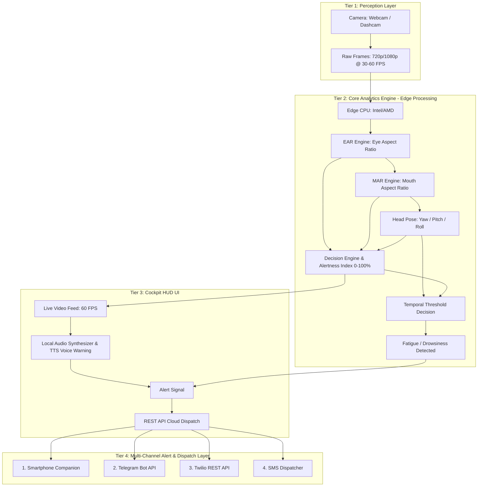

# 🚗 Smart Driver Safety and Fatigue Detection System (4-Tier Architecture)

An AI-powered, real-time **Driver Safety, Drowsiness, and Fatigue Monitoring System** designed exactly around a **4-Tier Architecture** that captures raw camera frames, computes facial geometry on the edge, visualizes real-time telemetry on a Cockpit HUD, and triggers **REST API Cloud Dispatch across 4 multi-channel alert networks**.

---

## 🏛️ System Architecture (Flowchart Blueprint)



---

## 🌟 4-Tier Breakdown & Implementation

### **Tier 1: Perception Layer**
- **Camera Sensor**: Laptop webcam, USB dashcam, or infrared cabin camera.
- **Raw Frames**: Streamed at **720p/1080p @ 30–60 FPS** for low-latency temporal processing.

### **Tier 2: Core Analytics Engine (Edge Processing)**
- **Edge CPU Processing**: Powered by MediaPipe 468-point facial mesh and Euclidean distance analytics running on edge CPU.
- **EAR Engine (Eye Aspect Ratio)**:
  $$EAR = \frac{||p_2 - p_6|| + ||p_3 - p_5||}{2 \times ||p_1 - p_4||}$$
  Monitors eyelid openness and microsleeps ($EAR < 0.20$ for $>10$ consecutive frames).
- **MAR Engine (Mouth Aspect Ratio)**:
  $$MAR = \frac{||p_{\text{top\_inner}} - p_{\text{bottom\_inner}}||}{||p_{\text{left\_corner}} - p_{\text{right\_corner}}||}$$
  Tracks yawning and mouth fatigue ($MAR > 0.48$).
- **Head Pose Engine**: Calculates 3D yaw, pitch, and roll to track driver distraction and looking down at phones.
- **Decision Engine & Alertness Index (0–100%)**: Continuous dynamic safety score evaluated in real-time.
- **Temporal Threshold Decision**: Temporal sliding window filtering to eliminate false positives.

### **Tier 3: Cockpit HUD UI**
- **Live Video Feed (60 FPS)**: Cockpit dashboard with face mesh overlays and bounding boxes.
- **Local Audio Synthesizer & TTS**: Cabin audio buzzer sirens and SpeechSynthesis voice warnings (*"Warning! Driver drowsiness detected! Wake up!"*).
- **Alert Signal**: Dispatches safety triggers.
- **REST API Cloud Dispatch**: Central endpoint (`POST /api/dispatch`) orchestrating the cloud fan-out to Tier 4.

### **Tier 4: Multi-Channel Alert & Dispatch Layer**
The central Cloud Dispatch fans out across 4 dedicated channels simultaneously:
1. **📱 Smartphone Companion (Channel 1)**:
   - Pairs instantly via QR code on local Wi-Fi or hotspot.
   - Connected via persistent real-time WebSockets (`/ws`).
   - Triggers **hardware phone vibration** (`navigator.vibrate()`).
   - Plays **loud emergency siren** directly on the phone speaker.
   - Flashes **fullscreen red strobe beacon**.
   - Displays live driver snapshot evidence photos and telemetry.
2. **✈️ Telegram Bot API (Channel 2)**:
   - Dispatches instant alerts and high-res driver photo snapshots directly to Telegram chat/channel using Telegram Bot API (`sendPhoto` and `sendMessage`).
   - Uses clean HTML formatting with timestamps and metrics.
3. **📞 Twilio REST API (Channel 3)**:
   - Dispatches via Twilio REST API (`https://api.twilio.com/2010-04-01/Accounts/...`).
   - Supports **WhatsApp alerts**, **Twilio SMS**, or **Automated Voice Calls**.
4. **💬 SMS Dispatcher (Channel 4)**:
   - Dedicated SMS channel with multi-provider support:
     - **Cellular GSM Simulator**: Out-of-the-box local cellular SMS simulator with live SMS Inbox & carrier receipts for offline demonstrations.
     - **Fast2SMS Gateway**: Direct SMS gateway API.
     - **Twilio Programmable SMS**: Direct cellular SMS delivery.
     - **Generic HTTP Gateway**: Custom SMS webhooks.

---

## 🚀 Quick Start Guide

### 1. Requirements
- Python 3.9+ installed.
- Webcam (built-in laptop webcam or USB dashcam).

### 2. Launch System
Double-click `run.bat` or run:
```bash
python start.py
```

Open your browser to:
- **Cockpit Dashboard**: `http://localhost:8000/`
- **Mobile Phone Companion**: `http://<your-local-ip>:8000/companion` (or scan the QR code on the dashboard)

---

## 🧪 Testing Tier 4 Multi-Channel Dispatch

You can test Tier 4 dispatching at any time without triggering real drowsiness:
1. Open `http://localhost:8000/`.
2. Scroll to the **Tier 4: Multi-Channel Alert & Dispatch Layer** panel.
3. Click **"Test All 4 Channels (Cloud Dispatch)"**.
4. Observe:
   - Channel 1 (Phone Companion): Triggers vibration & siren on paired phones.
   - Channel 2 (Telegram Bot API): Sends test alert to your Telegram chat.
   - Channel 3 (Twilio REST API): Dispatches Twilio message/WhatsApp.
   - Channel 4 (SMS Dispatcher): Delivers SMS text message and records in SMS Inbox.
   - The **Live Cloud Dispatch Terminal** logs the real-time delivery receipt for each channel!

You can also test each channel individually using the dedicated test buttons:
- `Test Buzz` (Smartphone)
- `Test Telegram` (Telegram Bot)
- `Test Twilio` (Twilio REST)
- `Test SMS` (SMS Dispatcher)

---

## 📁 Project Structure

```
c:/xampp/htdocs/majorpr/major/
├── backend/
│   ├── app.py                  # FastAPI server with Tier 3 & 4 REST Cloud Dispatch
│   ├── detector.py             # Tier 2 CV algorithms (EAR, MAR, Head Pose, Alertness Index)
│   ├── notifier.py             # Tier 4 Notifier (Companion, Telegram, Twilio, SMS)
│   ├── config.json             # Persisted configuration for all 4 tiers
│   ├── requirements.txt        # Python package dependencies
│   └── snapshots/              # Captured incident evidence photos
├── frontend/
│   ├── index.html              # Cockpit HUD Dashboard & Tier 4 Hub
│   ├── companion.html          # Mobile Phone Companion Receiver (Channel 1)
│   ├── css/
│   │   ├── style.css           # Luxury dark cockpit HUD & Tier 4 stylesheet
│   │   └── companion.css       # Mobile-optimized companion styles
│   └── js/
│       ├── app.js              # Cockpit controller & REST Cloud Dispatcher
│       ├── vision.js           # MediaPipe FaceMesh & EAR/MAR detector
│       ├── audio.js            # Web Audio alarm synthesizer & TTS voice engine
│       ├── charts.js           # Chart.js real-time telemetry graphs
│       ├── socket.js           # WebSocket client
│       └── companion.js        # Mobile companion vibration & siren controller
├── start.py                    # Python launch script
├── run.bat                     # Windows batch launcher
├── test_server.py              # Automated Tier 4 cloud dispatch test suite
├── test_websocket.py           # WebSocket real-time phone alert test suite
└── README.md                   # Complete documentation
```
